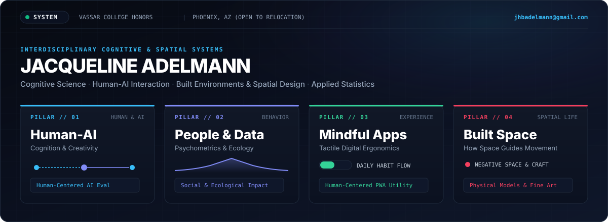
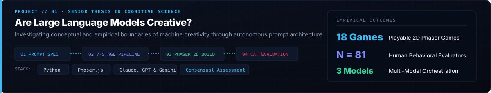
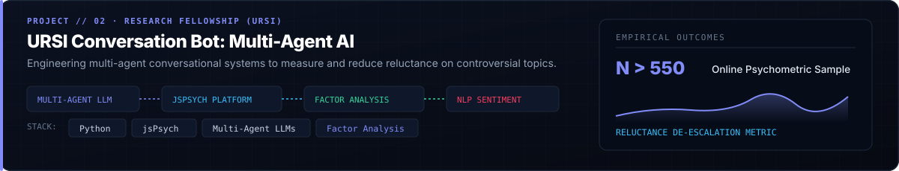
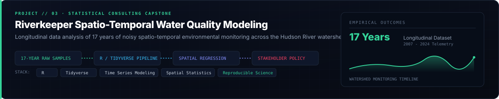
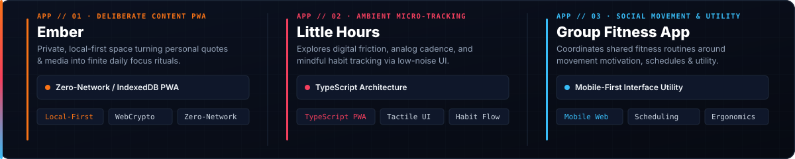
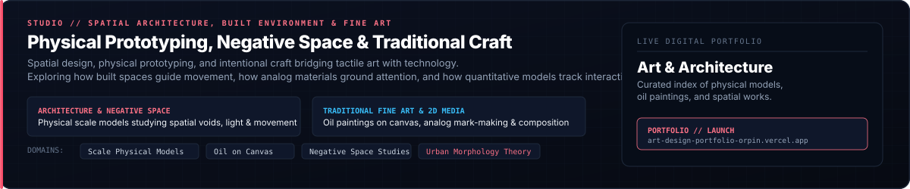
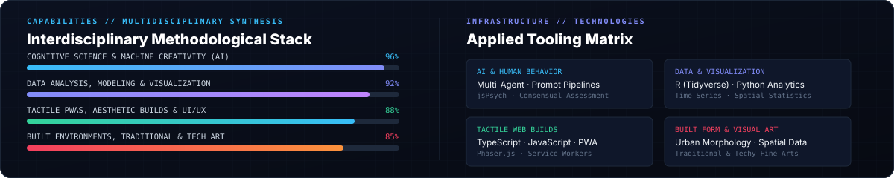
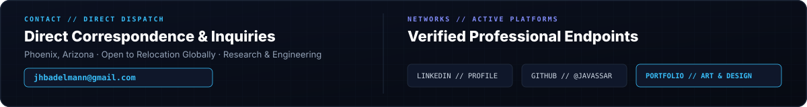

<p align="center">
  <a href="https://github.com/javassar">
    
  </a>
  
</p>

<p align="center">
  <a href="https://www.linkedin.com/in/jacquelineadelmann"></a>
  <a href="https://art-design-portfolio-orpin.vercel.app"></a>
  <a href="mailto:jhbadelmann@gmail.com"></a>
</p>

<br />

## Overview & Foundations

```yaml
Jacqueline_Adelmann:
  Focus: Interdisciplinary Synthesis of Cognitive Science, Artificial Intelligence, and Aesthetic Systems
  Domains:
    - Artificial Intelligence, Machine Creativity & Cognitive Modeling
    - Human Behavior, Psychometrics & Behavioral Experimentation
    - Empirical Data Analysis, Spatial Statistics & Data Visualization
    - Built Environments, Urban Morphology & Spatial Design
    - Creative Technology, Tactile Application Engineering & Aesthetic Builds
    - Traditional Fine Arts & Computational Visual Systems
  Degree: B.A. with Honors, Vassar College
  Majors: Mathematics/Statistics & Cognitive Science
  Pathway: Urban Studies & Architecture
  Location: Phoenix, Arizona (Open to Relocation Worldwide)
  Portfolio: https://art-design-portfolio-orpin.vercel.app
  Contact: jhbadelmann@gmail.com
```

<br />

## Research & Cognitive Systems Architecture

<p align="center">
  <a href="https://github.com/javassar/thesis">
    
  </a>
</p>
<p align="right">
  <sub><a href="https://github.com/javassar/thesis">Launch Thesis Repository →</a></sub>
</p>

<br />

<p align="center">
  <a href="https://github.com/jodeleeuw/URSI-LLM-Convo-Bot">
    
  </a>
</p>
<p align="right">
  <sub><a href="https://github.com/jodeleeuw/URSI-LLM-Convo-Bot">View URSI Research Project →</a></sub>
</p>

<br />

<p align="center">
  <a href="https://github.com/301-CCC/projects-riverkeeper">
    
  </a>
</p>
<p align="right">
  <sub><a href="https://github.com/301-CCC/projects-riverkeeper">View Riverkeeper Capstone Repository →</a></sub>
</p>

<br />

## Product Design, Spatial Architecture &amp; Tactile Art

<p align="center">
  <a href="https://github.com/javassar">
    
  </a>
</p>
<p align="right">
  <sub><a href="https://github.com/javassar/littlehours">View Little Hours PWA</a> &nbsp;·&nbsp; <a href="https://github.com/javassar/group-fitness-app">View Group Fitness App</a></sub>
</p>

<br />

<p align="center">
  <a href="https://art-design-portfolio-orpin.vercel.app">
    
  </a>
</p>
<p align="right">
  <sub><a href="https://art-design-portfolio-orpin.vercel.app">Launch Art &amp; Architecture Portfolio →</a></sub>
</p>

<br />

## Capabilities &amp; Technical Stack

<p align="center">
  
</p>

<br />

<p align="center">
  
</p>

<p align="center"><sub>Frameworks &amp; Methodologies: &nbsp;<code>Phaser.js</code> <code>jsPsych</code> <code>Tidyverse</code> <code>Multi-Agent Systems</code> <code>Prompt Pipelines</code> <code>Spatial Analytics</code> <code>Information Design</code></sub></p>

<p align="center">
  
</p>

<br />

## Direct Inquiries &amp; Contact Terminal

<p align="center">
  <a href="mailto:jhbadelmann@gmail.com">
    
  </a>
</p>

<br />

<p align="center">
  <a href="mailto:jhbadelmann@gmail.com"></a>
  <a href="https://www.linkedin.com/in/jacquelineadelmann"></a>
  <a href="https://art-design-portfolio-orpin.vercel.app"></a>
  <a href="https://github.com/javassar"></a>
</p>

<br />

<p align="center">
  
</p>
